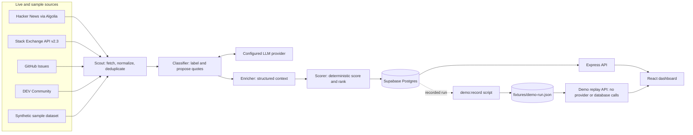

# Vantage

Vantage is a go-to-market intelligence dashboard for B2B SaaS sellers. It searches public posts for people describing relevant problems, classifies and ranks the resulting signals, and shows the evidence and score behind each decision.

Vantage produces public-post signals, not contact records. It does not provide contact details or send messages. A person decides what to do with the evidence and links.

## How the pipeline works



## Features available now

- Search Hacker News through the free Algolia API. The footer attributes the search to Algolia.
- Search Software Recommendations and Software Engineering questions through the official Stack Exchange API; each result links to its original question and shows its author.
- Search public GitHub issues (a `GITHUB_TOKEN` is optional and recommended for higher search limits) and DEV Community articles through Forem's documented article-search endpoint. GitHub and DEV results retain source metadata and search provenance.
- Product Hunt is currently blocked and never sends API requests: its API terms prohibit commercial use without permission, so do not enable it until permitted use is confirmed.
- Run the synthetic sample dataset for repeatable demonstrations and evaluation. The sample posts are labelled as sample data, have no real-post link, and ignore the search keywords.
- Classify posts as buyer intent, competitor complaint, venting, or noise; verify proposed evidence quotes against stored post text and discard quotes that do not match.
- Enrich signals and rank buyer-intent signals before competitor complaints. The Scorer is code; it computes scores from the configured weights, half-life, and engagement cap.
- Inspect source events, signal details, highlighted evidence, score components, and Accept/Reject status actions.
- View a report and export it as CSV or print it to PDF.
- Replay a recorded run in demo mode. The API makes no database, model, or source calls in this mode and the dashboard displays a demo banner.

## Quick start

Requirements: Node.js 20 or later, as specified by the root `package.json` engines field, and npm. Install workspace dependencies with `npm install`.

1. Copy `.env.example` to `.env`, then set the variable names listed in the environment table below. Do not commit `.env`.
2. In the Supabase SQL editor, apply [`0001_init.sql`](supabase/migrations/0001_init.sql) through [`0005_signal_metadata.sql`](supabase/migrations/0005_signal_metadata.sql) in numeric order, then [`seed.sql`](supabase/seed.sql). Migration 0005 adds nullable content metadata fields and is required for GitHub/DEV persistence. Do not run the migrations through the app; an operator applies them manually.
3. Start the API with `npm run dev:api` (port 3001 by default).
4. Start the web app with `npm run dev:web`. The Vite server port is not set explicitly in `apps/web/vite.config.ts` (not verified here); it proxies `/api` to the API on port 3001.

The API configuration requires `SUPABASE_URL`, `SUPABASE_SERVICE_ROLE_KEY`, and `REDDIT_USER_AGENT` to be non-empty in normal mode. At least one provider key is needed for classifier calls; the LLM keys are optional to the environment schema and the classifier may be unavailable without a configured provider.

## Environment variables

Names and requiredness below come from `apps/api/src/config/env.ts`; purposes are based on current configuration and use. The repository-root `.env.example` contains an empty entry for each optional credential accepted by the schema.

| Name | Required? | Purpose |
|---|---|---|
| `SUPABASE_URL` | Yes | Supabase project URL for the API. |
| `SUPABASE_SERVICE_ROLE_KEY` | Yes | Service-role access used by the API database client. |
| `SUPABASE_ANON_KEY` | No | Optional Supabase anonymous key accepted by configuration. |
| `GEMINI_API_KEY` | No | Optional Gemini provider credential. |
| `GEMINI_MODEL` | No | Override the configured Gemini model. |
| `GROQ_API_KEY` | No | Optional Groq provider credential. |
| `GROQ_MODEL` | No | Override the configured Groq model. |
| `LLM_PROVIDER_ORDER` | No | Provider order; defaults to Groq then Gemini. |
| `ENABLE_CRITIC` | No | Enables the optional second-opinion evidence review; defaults to `true`. |
| `ENABLE_DISPLACEMENT` | No | Enables local embedding-based competitor complaint themes; defaults to `true`. |
| `REDDIT_USER_AGENT` | Yes | Required by current environment validation; Reddit access is not implemented. |
| `REDDIT_CLIENT_ID` | No | Reserved optional Reddit API credential; adapter not implemented. |
| `REDDIT_CLIENT_SECRET` | No | Reserved optional Reddit API credential; adapter not implemented. |
| `STACKEXCHANGE_KEY` | No | Optional Stack Exchange application key; without one, the API has a lower daily quota. |
| `STACKEXCHANGE_SITES` | No | Optional comma-separated Stack Exchange site IDs; defaults to `softwarerecs` and uses at most three valid IDs. |
| `GITHUB_TOKEN` | No | Optional GitHub REST token; improves the issue-search request limit. |
| `PRODUCT_HUNT_TOKEN` | No | Optional Product Hunt developer token; retrieval remains blocked until permitted use is confirmed. |
| `DEMO_MODE` | No | Selects recorded replay mode when set to `true`; defaults to live mode. |
| `PORT` | No | API listening port; defaults to 3001. |

## Recorded demo mode

Record an already completed database run with `npm run demo:record -- --run <run-id>`. The default output is `fixtures/demo-run.json`; the recorder can also take `--out <path>`. The fixture is a recording of one run and must be supplied separately if it is not present in the checkout.

Set `DEMO_MODE` to `true` in `.env`, then start the API and web app with `npm run dev:api` and `npm run dev:web`. The replay API uses the recorded fixture and keeps Accept/Reject changes in memory only. It does not call Supabase, an LLM provider, Hacker News, or another network source.

## Testing and available scripts

Scripts verified for this project are `npm run typecheck`, `npm test -- --reporter=verbose --no-isolate --no-file-parallelism`, and `npm run build --workspace @vantage/web`.

Root scripts: `npm run dev:api`, `npm run dev:web`, `npm run typecheck`, `npm test`, `npm run scout`, `npm run demo:record`, `npm run llm:check`, `npm run embed:check`, `npm run eval:sample`, and `npm run eval:recall`. Workspace scripts include API `dev`, `typecheck`, `scout`, `demo:record`, `llm:check`, `embed:check`, `eval:sample`, and `eval:recall`; web `dev`, `build`, and `typecheck`; shared `typecheck`.

The first displacement run downloads about 25 MB of quantized model files from Hugging Face and caches them under `.cache/transformers`; later runs use the cache. Run `npm run embed:check` to inspect the local embedding setup. Set `ENABLE_DISPLACEMENT=false` to disable theme generation.

To evaluate known threads against live source retrieval, fill in [`fixtures/eval/github-dev-recall.json`](fixtures/eval/github-dev-recall.json), then run `npm run eval:recall -- fixtures/eval/github-dev-recall.json --verbose`. The included expected-thread titles are placeholders. Configure `GITHUB_TOKEN` in your local `.env` for the preferred GitHub search quota; DEV does not require a token. Product Hunt retrieval remains blocked pending confirmation of permitted API use.

See [the evaluation](docs/EVALUATION.md) for the synthetic and informal live observations.

## Project layout and status

```text
apps/
  api/       Express API, source adapters, pipeline, database access, scripts
  web/       React dashboard and report
packages/
  shared/    Zod schemas and shared TypeScript types
supabase/   migrations and seed data
fixtures/   seller, synthetic posts, and recorded demo run
docs/       demo script, evaluation, limitations and ethics
```

Implemented phases reflected in the current architecture amendments include 12A retrieval improvements and 12B GitHub/DEV sources. Product Hunt is intentionally blocked pending permitted-use confirmation. Reddit, other developer-forum and review-site adapters, the approach suggester, Monitor, authentication, broader row-level-security policies, deployment, accessibility audit, and load testing are not implemented. See [ARCHITECTURE.md](ARCHITECTURE.md) for design and phase details.

More documentation: [presentation script](docs/DEMO_SCRIPT.md), [evaluation](docs/EVALUATION.md), and [limitations and ethics](docs/LIMITATIONS_AND_ETHICS.md).

Hacker News searches each keyword with separate Ask HN and story/comment requests, then combines results across keywords.
