# Vantage Project Context for the Academic Report

## Purpose of this brief

Use this file as project-specific context when drafting the academic report from the student's outline. It explains what Vantage is, how the checked-out implementation is organized, what evidence is available, and what still needs to come from the student. It is not itself the final report, and it does not supply screenshots or claim that external services were tested.

### Evidence and accuracy rules

1. Treat the current source code and the latest applicable amendments in `ARCHITECTURE.md` as the implementation source of truth. The architecture document contains historical sections and later amendments; later accepted amendments supersede earlier designs where they conflict.
2. Use `README.md` for current setup and feature summaries, and inspect the relevant code and tests before making detailed claims. Some supporting documents are historical and can describe an earlier phase.
3. Separate implemented behavior, automated-test evidence, historical observations, and unverified live behavior. A passing test suite does not prove source API availability, LLM quality, production readiness, or live database behavior.
4. Do not invent dates, team size, institutional details, project schedule, budget, repository URL/access, demo video URL, deployment, screenshots, or results. Use `[AUTHOR TO FILL]` markers and ask the student for evidence.
5. Vantage discovers and presents public-post signals. It is not a contact database and does not contact people. Do not describe it as sending outreach or producing leads with contact details.
6. No images were supplied for this writing task. Mark screenshot locations with captions/placeholders; the student must capture authentic screenshots from the running app and tools.

## Project profile

Vantage is a university software-engineering lab project: a go-to-market intelligence dashboard for B2B SaaS sellers. A seller describes a product and its ideal customer or problem space. Vantage searches selected public sources for posts that may express relevant pain, classifies and ranks the resulting signals, and presents the post, evidence, score components, provenance, and links so a human can inspect the result.

The core output is a **signal**: a public post with source, author handle when available, text, date, engagement when available, and permalink. Vantage does not return private contact details and does not send messages. Classification and ranking are decision support; a human must verify the source post and decide what it means.

### Problem statement and motivation

B2B sellers need to find public discussions that indicate a customer problem, buying intent, or dissatisfaction with a competing product. Manually searching multiple forums is slow and produces a large amount of irrelevant material. Vantage aims to consolidate discovery and make the filtering and ranking inspectable, with links to the original posts.

Phrase this as the project's motivation, not as proof that Vantage has solved the market-wide problem. The repo contains informal and synthetic evaluations, not a controlled comparative study.

### Objectives supported by the implementation

- Collect public posts from supported sources for a seller-defined product/search profile.
- Normalize, deduplicate, and retain source/query provenance for collected records.
- Exclude clearly irrelevant items before classification using a configurable local-embedding relevance gate.
- Classify candidate posts into intent/complaint/venting/noise labels and validate model output.
- Preserve literal evidence quotes from the stored post text and explain decisions through traces.
- Enrich context and compute score/rank using deterministic application code.
- Optionally audit classifier evidence with a separate Critic decision and cluster competitor complaints into local-embedding themes.
- Show pipeline progress, source details, signal journeys, reports, and competitor context in a web dashboard.
- Support replay of a recorded demonstration without live source, LLM, or database calls.

## Scope, boundaries, and limitations

Current live retrieval adapters include Hacker News (Algolia), Stack Exchange, GitHub Issues, and DEV Community. A synthetic sample source supports repeatable demonstrations/evaluation. Product Hunt is intentionally blocked in the current README pending confirmation of permitted use; do not imply it is operational. Reddit is not implemented; repository documentation notes that it is awaiting official credentials/API access. Other sources discussed as future ideas are not implemented unless current code proves otherwise.

The system depends on third-party APIs, their quotas, availability, and content quality. Public posts can be irrelevant, outdated, ambiguous, or authored by automation. Retrieval is not exhaustive. Classification can fail or be wrong, evidence verification only checks quotation against stored text (not the truth of the claim), and local clusters are not proof that a market segment exists. The optional embedding model may download/cache on first live use. Production security, broad load testing, a formal accessibility audit, and deployment should be described only if independently verified.

The data model and UI are designed around public material and evidence traceability. State the project's privacy and ethics safeguards without asserting legal compliance certification.

## Report outline: Vantage-specific writing and evidence map

### 1. Introduction

#### 1.1 Background and motivation

Introduce B2B go-to-market research and the time cost of finding public discussions across separate communities. Position Vantage as an evidence-first discovery dashboard, not automated sales outreach.

#### 1.2 Problem statement

Possible concise formulation: “How can a seller efficiently discover and review relevant public discussions of customer problems across multiple online sources while retaining transparent evidence and human control?” The student may refine this to match the course project brief.

#### 1.3 Objectives

Use the supported objectives above. If the report needs measurable objectives, distinguish implementation objectives (e.g., API, pipeline, trace UI) from quality targets. Do not invent achieved accuracy, recall, latency, or adoption targets.

#### 1.4 Scope and limitations

Describe current supported sources and features, synthetic replay, human review, public-post-only output, API/rate-limit dependence, and known evaluation limitations. List deferred sources/features separately from implemented scope.

### 2. Literature survey / existing system

This repository does not contain a complete scholarly literature review. Research and cite primary/credible sources separately: existing social listening, product-feedback, forum-search, and sales-intelligence approaches; official platform API documentation; and relevant academic work on information retrieval, text classification, embeddings, clustering, explainable AI, and privacy.

Use an honest comparison matrix with criteria such as sources, multi-source workflow, explainability, human review, evidence links, and automation. Avoid unsupported claims that competitors lack a feature. A defensible gap statement is the project's design motivation: consolidating public-source retrieval with inspectable classification and evidence in one workflow.

### 3. Software process model and project planning

The repository's numbered phase/feature history and incremental implementation are consistent with an **iterative, incremental process**. Describe that as an inference from project artifacts, and have the student confirm the actual team process before calling it Scrum or claiming sprints, ceremonies, or formal reviews.

- Project schedule: `[AUTHOR TO FILL: actual dates, milestones, team allocation]`. Derive milestones from Git history/phase history only after checking timestamps and confirming the intended academic period. A phase list is not automatically a dated Gantt chart.
- Risk analysis: reasonable project-specific risks include API quota/outage, irrelevant or sparse retrieval, model/provider unavailability or output errors, embedding download/cache/runtime issues, privacy/ethics concerns, and limited evaluation data. Label qualitative likelihood/impact as team assessment, not measured statistics.
- Cost/effort: optional. No budget or labor-hour evidence is present here; do not estimate as fact.

### 4. Requirements analysis

Turn the following into numbered requirements if helpful. Keep implementation facts separate from inferred requirements.

**Functional requirement candidates:** define a seller/search profile; choose supported sources; start and monitor a run; collect and normalize public posts; deduplicate and retain provenance; gate relevance; classify and validate evidence; enrich and score deterministically; inspect pipeline stage details and signal journey; view themes and co-mention context; accept/reject signals where available; produce a report/export; and replay the synthetic recorded demo.

**Non-functional requirement candidates:** TypeScript strict type checking; schema validation of model output; explainable trace records; graceful source/provider failure; deterministic scoring; privacy-respecting public-post-only scope; maintainable workspace separation; accessible responsive UI and reduced-motion support; testability with fake providers/embedders and no real network/database in automated tests. Verify each against code/tests before stating it as achieved.

**SRS summary:** describe actors (seller/reviewer/operator), inputs (product profile, keywords, source choices), processing (retrieval through scoring), outputs (ranked signal report, evidence and provenance), external dependencies, and constraints. The API requires configuration and a Supabase database in live mode; demo replay is a separate path.

**Hardware/software requirements:** README specifies Node.js 20 or later and npm. The software stack is listed below. No special hardware benchmark is documented. State a standard development computer as a practical assumption only, and mark exact OS/browser/database-host requirements `[AUTHOR TO FILL / VERIFY]`.

### 5. System design

#### 5.1 Architecture and data flow

The repository describes an npm-workspaces monorepo: `apps/api` is the Express/TypeScript service and pipeline; `apps/web` is the React/Vite dashboard; `packages/shared` contains shared Zod schemas and types. Supabase Postgres is used by live mode. SQL migrations are applied by an operator, not automatically by the app. Recorded demo replay uses a fixture and avoids provider/source/database calls.

Current conceptual flow:

```mermaid
flowchart LR
  Profile[Seller profile and source selection] --> Sources[HN, Stack Exchange, GitHub, DEV]
  Sample[Synthetic sample source] --> Scout[Scout: retrieve, normalize, deduplicate, log provenance]
  Sources --> Scout
  Scout --> Gate[Local-embedding relevance gate]
  Gate --> Classifier[Classifier: validated label and evidence]
  Classifier --> Critic[Optional Critic: separate evidence review]
  Critic --> Enricher[Enricher: structured context]
  Enricher --> Scorer[Deterministic score and rank]
  Scorer --> Displacement[Optional local embedding themes]
  Displacement --> Store[(Supabase Postgres in live mode)]
  Store --> API[Express API]
  API --> UI[React/Vite dashboard]
  Fixture[Recorded demo fixture] --> Replay[Demo replay API]
  Replay --> UI
```



Check the current pipeline implementation before claiming exact stage ordering or conditional behavior. Critic, displacement, and some sources are optional/configurable. Scores are computed in code rather than generated by the LLM. Theme generation is local-embedding/clustering based, not a third LLM call.

#### 5.2 Use case diagram

Suggested actors/use cases, to verify from current routes/UI: Seller/Analyst creates a search, selects sources and starts a run; monitors pipeline; reviews ranked and other signals; opens evidence and trace; inspects themes/report; exports or prints report; accepts/rejects a signal. Operator configures environment, applies migrations, and records a demo. Draw this as a proposed model of implemented interactions, not a claim that UML source is present.

#### 5.3 Class/module diagram

Prefer a module/component diagram over a fabricated object-oriented class model. Candidate modules: source adapters, Scout/query generation, relevance/displacement utilities, classifier/critic/enricher/scorer agents, database stores, Express routes, shared schemas/types, and web pages/components. Generate names from code if a precise diagram is required.

#### 5.4 Sequence/activity diagrams

Useful sequences: live run request → pipeline stages → persisted events/decisions → web progress; and demo replay request → fixture-backed API → UI. Show source/provider failures as degraded/recorded outcomes only after checking the current implementation. For activity diagrams, show relevance exclusion and optional stages as branches.

#### 5.5 ER/database design

The current design is run-oriented and stores sellers/search profiles, runs, normalized signals/leads, decisions/traces, run events, request logs/provenance, themes, and feedback, with migrations under `supabase/migrations`. Use actual migration SQL to create the ER diagram and confirm exact table/column names, keys, and relationships. Do not infer a schema from the UI types alone. No new migration is applied automatically.

#### 5.6 UI design / wireframes

Current visual direction is a light, white and pale blue-grey B2B dashboard with a slim top navigation, centered content, accessible text-first badges, quiet borders, and reduced-motion support. Major screens include search setup, run overview/live pipeline, inbox, signal detail/journey, competitor themes, and report. The report has print/export support. Create wireframes or screenshots from the current app; do not reproduce an earlier dark-sidebar design found in historical assets.

### 6. Implementation

#### 6.1 Technology stack

| Layer | Current technology | Evidence/location |
|---|---|---|
| Runtime and workspaces | Node.js (README: 20+) and npm workspaces | root `package.json`, workspace manifests |
| Language | TypeScript, strict project configuration | workspace `tsconfig.json` files; do not alter them |
| API | Node.js, Express 5, tsx | `apps/api/package.json`, `apps/api/src` |
| Web | React 19, Vite 8 | `apps/web/package.json`, `apps/web/src` |
| Shared contracts | Zod schemas and TypeScript types | `packages/shared/src` |
| Persistence | Supabase JS/Postgres; migrations and seed SQL | `apps/api/src/db`, `supabase/` |
| LLM | provider client with configured Groq/Gemini ordering and validated output | `apps/api/src/llm`, config and env modules |
| Local embeddings | `@huggingface/transformers` for the displacement/relevance embedding path | API dependency and displacement/retrieval modules; first-run model availability must be checked |
| Clustering | DBSCAN utility used for competitor complaint themes | `apps/api/src/utils` and displacement agent |
| Tests | Vitest, offline fakes/mocks for sources/providers/embeddings | root `vitest.config.ts`, `apps/api/test`, `apps/web/src/**/*.test.*`, shared tests |

Versions change; quote exact versions only after reading the current lockfile/manifests at report-writing time.

#### 6.2 Module description

- `apps/api/src/sources`: adapters for supported public-source APIs and normalization.
- `apps/api/src/agents`: pipeline agents, including classification, optional Critic review, and displacement/theme clustering.
- `apps/api/src/orchestrator`: run orchestration, stage ordering, events, and graceful degradation.
- `apps/api/src/llm`: provider request/response handling, prompts, schemas, retries/fallback as implemented.
- `apps/api/src/db`: persistence and query helpers for runs, signals/leads, decisions, events, themes, request logs, and journey details.
- `apps/api/src/routes`: HTTP API endpoints and validation.
- `apps/api/src/config`, `utils`, `scoring`: parsed configuration, reusable utilities, and deterministic score logic.
- `apps/web/src`: React pages/components for setup, run trace, inbox, signal journey, themes/graph, and report.
- `packages/shared/src`: shared schemas, enums/constants, and API/domain types.
- `supabase/migrations`: operator-run database changes; `fixtures/`: sample and replay/evaluation inputs; `docs/`: design, evaluation, demo, limitations, and handover notes.

#### 6.3 Key code snippets

Keep any snippets short and explain the invariant they demonstrate. Good candidates are: schema-validated model output; literal quote verification; deterministic score computation; graceful source failure/event recording; or trace assembly. Copy only from current code, cite the source file and line, and do not imply a short excerpt is the full implementation. Full source remains in the repository.

### 7. Software tools used and demo screenshots

Use three tools with evidence. The following are supported by the repository; capture actual screenshots from the student's machine if the assignment requires them.

| Tool | Purpose | Phase of SDLC | Usage in Vantage | Evidence/screenshot |
|---|---|---|---|---|
| Git (and GitHub only if the remote/account is verified) | Version control and change history | Implementation, integration, maintenance | Repository has Git history and phase-based commits. Public hosting/access is not established by this brief. | `[Insert screenshot of repository history or remote; redact private details]` |
| Node.js and npm | Runtime, dependency/workspace management, scripts | Development, build, test | Runs API/web scripts, typechecks, and workspace tests. | `[Insert terminal screenshot showing a non-secret command and result]` |
| Vitest | Automated testing | Verification | Executes API/shared/web tests; fakes are used for external systems in offline test coverage. | `[Insert test summary screenshot]` |
| TypeScript | Static type checking | Implementation, verification | Strictly typed API, shared package, and web workspaces. | `[Optional screenshot of typecheck result/editor]` |
| Vite / React | Web development and production build | Implementation, verification | Runs the dashboard dev server and builds the web app. | `[Optional screenshot of current UI/build]` |
| Supabase | Hosted Postgres/backend service | Integration/runtime | Configured as live-mode persistence. Do not claim a live connection was tested unless the student provides evidence. | `[Optional dashboard screenshot with project identifiers/secrets hidden]` |

The assignment asks for at least three tools; choose three or more from verified entries. Do not claim Jira, Trello, Figma, Postman, Docker, Selenium, or other tools were used without student-provided evidence. Add a caption and state what each screenshot demonstrates.

### 8. Testing

#### 8.1 Test strategy

The project uses Vitest and a workspace typecheck. Tests should use fake source fetches, fake LLM providers, fake embedders, and in-memory/mock persistence as appropriate; automated tests must not call real providers, APIs, or Supabase. The documented full-suite workaround is:

```text
npm test -- --reporter=verbose --no-isolate --no-file-parallelism
```

Also report `npm run typecheck` and `npm run build --workspace @vantage/web` when run. Record the actual output and date from the final submission checkout; don't copy old results as current.

#### 8.2 Test cases and 8.3 results/bug log

Build a report table from actual test names/results with columns: ID, input/setup, expected result, actual result, status. Useful categories include schema validation, source normalization/pagination/rate limits/failures, dedupe/provenance, query generation, relevance-gate filtering/cap, classifier label/quote validation, provider retries/fallback, Critic failure reasons, score determinism, displacement clustering, pipeline warnings/degradation, route validation, demo replay, signal journey, UI states/accessibility, and report output. Use actual test names from Vitest; the categories above are not proof every category has a test.

For the bug log, include only bugs actually observed and fixed/unresolved, with reproducible evidence. Do not invent bugs to fill a table. Clearly separate automated results from manual/live checks.

### 9. Results and discussion

Screenshots of the working system must be captured from a real run or the clearly marked synthetic demo. Suggested captures: setup, live/replayed run graph, ranked inbox, signal evidence/journey, competitor themes/graph, report/print view, and the three required development tools. Add captions, describe whether the data is synthetic or live, and redact credentials/personal information.

Discuss objectives against evidence: features demonstrated, test coverage, retrieval/evaluation limits, source failures, and explainability. An informal retrieval-recall evaluation and a synthetic classifier evaluation are not the same as production precision/recall or user validation. Do not generalize from one run.

### 10. Conclusion and future enhancements

Conclude only to the degree supported by the implemented system and evidence: Vantage integrates public-source discovery with traceable processing and human review. Future work may include permitted additional sources, stronger/held-out evaluation, operational monitoring, deployment hardening, broader accessibility/load testing, and product features listed as unimplemented in the current README/architecture. Label these as future work, not delivered functionality.

### 11. References (IEEE style)

The report author should verify and cite official technical documentation for APIs and frameworks actually discussed, plus scholarly sources for the literature review. Likely primary references include official Hacker News/Algolia, Stack Exchange API, GitHub REST, Forem/DEV API, React, Vite, TypeScript, Vitest, Supabase, and Transformers.js documentation. Cite the exact page/version consulted and access date. Do not fabricate paper titles, authors, access dates, API guarantees, or a citation merely because a link is listed in repository docs.

## Appendices and student-supplied evidence

### Appendix A: project links

- GitHub repository: `[AUTHOR TO FILL: URL; verify public or faculty access]`
- Demo video: `[AUTHOR TO FILL: Drive URL; verify “anyone with the link can view” in a private/incognito window]`
- README setup steps: present in repo; verify they match the final code and environment before submission.

### Appendix B: sample code

Optional short listings may be included with source-file references. Avoid duplicating large files; the repository is the source for complete code.

### Evidence the student must provide or confirm

- University, course, project title required by the cover page, student/team names, supervisor, and submission date.
- Actual project start/end dates, schedule/sprint history, team roles, and process model/ceremonies.
- Any effort/cost estimates and how they were calculated.
- Screenshots of the running UI, test output, and at least three tools; indicate live versus synthetic demo data.
- GitHub remote URL, sharing/public status, and demo video URL/access check.
- Any real API/database/LLM live checks and the date, configuration, and sanitized results.
- Final test/typecheck/build outputs from the exact version submitted.
- Confirmation of any claims about deployment, browser/OS support, accessibility audit, user testing, or production use.

## Important stale-document and evaluation cautions

The repository evolved through multiple numbered phases. In particular, read the newest architecture amendments (including sections 32 to 38) alongside the earlier design: later approved sections add local-embedding displacement, Critic review, live pipeline trace, competitor graph, visual redesign, signal journey, and Phase 12 discovery changes. Do not copy an earlier description that says these are absent if newer code/amendments show otherwise.

Some supporting docs such as the handover, evaluation, demo script, and limitations notes may predate recent changes. Check current code/tests and mark historic material as historical. The recent uncommitted Phase 12C-lite work means Git status may be dirty; do not claim a clean, released, or fully integrated final state unless rechecked. The last known HEAD in the context for this document is `a98de2c`, while several Phase 12C-lite files were already modified/untracked. Recheck before drafting.

`docs/EVALUATION.md` describes a historical synthetic evaluation (36 sample posts, 35/36 classified as expected) and notes significant limitations: no held-out dataset, limited labels, and evaluator/prompt authorship overlap. Treat these as historical evaluation notes, verify the current file before quoting, and do not present them as a validated model accuracy estimate. A separate TraceLite recall evaluation reported six expected threads retrieved, but retrieval recall on a small hand-picked set is not proof of high precision or general retrieval quality. Earlier live runs also showed noisy results and long runtimes; confirm exact run records before quoting numbers.

## Suggested report-generation workflow for Claude

1. Read this brief, `README.md`, all relevant current code, current tests, `ARCHITECTURE.md` amendments, and current Git status.
2. Draft the report using the student's numbering and preserve the distinctions between implemented, tested, historical, and unverified claims.
3. Use `[AUTHOR TO FILL]` wherever evidence is missing; do not fill it by guessing.
4. Include diagrams only from verified code/schema or label them as proposed. Use screenshot placeholders and captions; do not generate or pretend to have captured screenshots.
5. Cite primary documentation and academic literature in IEEE style after verifying every citation.
6. Include a compact evidence appendix or traceability table mapping key claims to files, tests, screenshots, or student confirmation.
