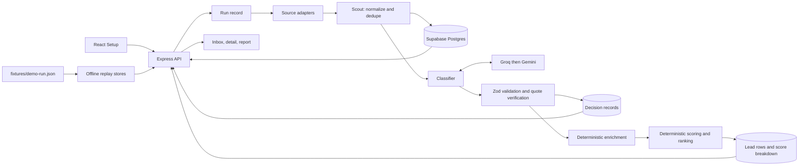

# Vantage project handover

**Purpose:** onboard a new engineer or coding assistant to the repository quickly
and accurately. This report describes the checked-out source as inspected on
2026-10-24. `AGENTS.md` and `ARCHITECTURE.md` remain the project instructions and
design references; this handover is a guide, not a replacement for either.

## 1. Read this first

1. Read the complete root `AGENTS.md` before making changes. It includes the
   project-specific operating rules and points to the user's RTK command rule.
2. Read `ARCHITECTURE.md`, especially its later phase amendments. It records
   intended contracts, source decisions, database changes, and unfinished work.
3. Read `README.md` for setup, scripts, the environment-variable names, and the
   currently supported product paths.
4. Read `docs/LIMITATIONS_AND_ETHICS.md`, `docs/EVALUATION.md`, and
   `docs/DEMO_SCRIPT.md` before presenting claims about model quality, live data,
   or demo behavior. `docs/DESIGN.md` documents the pending visual redesign's
   design tokens.
5. Inspect current Git status before editing. On the date of this report,
   the visual redesign was already present as uncommitted work; preserve it.

Never read or print `.env` or credentials, connect to the real Supabase project,
or run SQL unless the user explicitly instructs the exact action. Tests should
use fake fetches and fixtures, not live services. Do not send a valid `POST /runs`
during startup checks. Apply database migrations manually only when the
human asks; migrations are not run by application startup.

## 2. Product purpose and boundaries

Vantage is a go-to-market intelligence dashboard for B2B SaaS sellers. A user
describes a product, the problem it solves, an ideal customer, competitors, and
search terms. Vantage searches public posts, turns them into normalized
**signals**, classifies them, adds structured context, and computes a ranking.
The dashboard surfaces the underlying post, classification explanation,
verified evidence, score components, source provenance, and source link.

Vantage produces public-post signals, not contact records. It does not provide
contact details, automate outreach, or send messages. Synthetic fixture posts
must remain visibly identified as synthetic and must not be presented as real
source results. Treat labels and scores as decision support, not proof of
intent.

Core integrity constraints:

- Classification output is parsed with Zod before use. The model proposes a
  label, rationale, and rubric evidence; it does not assign the final score.
- Score and rank are computed by deterministic TypeScript code.
- The UI exposes reasoning and evidence so a person can inspect decisions.
- Agents do not hold cross-run memory. Persistent run data lives in Postgres;
  demo replay uses an explicit recorded fixture and only keeps feedback changes
  in memory.
- The intended evidence rule is that quotes must be found in the stored post.
  `apps/api/src/verification/verifyQuote.ts` currently normalizes case,
  whitespace, and selected quote/dash characters before matching, then maps
  evidence spans back to the stored text. Do not silently change this
  behavior; if strict byte-for-byte substring matching is required, treat that
  as a design decision and reconcile it with the current implementation.

## 3. Repository structure

```text
apps/
  api/
    src/
      agents/          Scout, classifier, enricher, scoring-stage orchestration
      config/          environment, source, rubric, LLM, scoring, demo settings
      db/              Supabase access and stores for runs, leads, decisions
      demo/            recorded-run Zod schema and offline replay stores
      evaluation/      evaluation metrics
      llm/             provider client and classifier prompt
      orchestrator/    pipeline sequencing and run-event emission
      report/          CSV serialization
      routes/          Express endpoints for runs, leads, and reports
      scoring/         pure score calculation and rank ordering
      scripts/         scout, demo recording, LLM check, sample evaluation
      sources/         adapter types, registration, HN, Stack Exchange, snapshot
      utils/           hashing, rate limits, redaction, concurrency, text cleanup
      verification/    quote matching and evidence-span mapping
    test/               Vitest tests with fake stores, fetches, clocks, fixtures
  web/
    src/
      app/              hash routing and root App shell
      components/       reusable status, evidence, score, source, and UI pieces
      hooks/            run/event/request polling hook
      lib/              API client, formatting, evidence, inbox filters
      pages/            Setup, Run, Inbox, signal detail, Report
      styles/           plain CSS tokens and component styles
packages/
  shared/src/            shared Zod schemas, constants, and inferred/domain types
supabase/
  migrations/             SQL migrations; human-applied
  seed.sql                local/demo seller seed
fixtures/                 sample seller, sample source data, HN response, run replay
docs/                     demo, evaluation, limitations, design, this handover
```

### Main files to know

| Path | Responsibility |
| --- | --- |
| `apps/api/src/index.ts` | Loads dotenv, chooses live or demo wiring, mounts Express routers, starts API. |
| `apps/api/src/orchestrator/runPipeline.ts` | Selects sources, runs Scout/classifier/scorer, records source requests/events, computes final status. |
| `apps/api/src/agents/scout.ts` | Calls adapters concurrently, collects source reports, deduplicates normalized signals. |
| `apps/api/src/agents/classifier.ts` | Orders/caps signals, reuses matching stored decisions, requests model classifications, writes decisions and counts. |
| `apps/api/src/llm/client.ts` | Gemini/Groq JSON requests, provider fallback, rate-limit retry, schema validation and provider circuit breaker. |
| `apps/api/src/verification/verifyQuote.ts` | Validates proposed quotes and maps verified evidence to original text spans. |
| `apps/api/src/agents/enricher.ts` | Pure feature extraction from text, seller competitors, source metadata and engagement. |
| `apps/api/src/scoring/computeScore.ts` | Pure score components, confidence helper, and deterministic label-tier ranking. |
| `apps/api/src/db/*.ts` | Store interfaces and Supabase-backed persistence/mapping. |
| `apps/api/src/sources/index.ts` | Registers the adapters that are actually implemented. |
| `apps/api/src/demo/replay.ts` | Adapts a validated fixture to the run/lead store interfaces without DB/network access. |
| `apps/api/src/routes/*.ts` | Validates requests/IDs and implements the HTTP surface. |
| `apps/web/src/lib/api.ts` | Browser API client; uses `/api` as the base path. |
| `apps/web/vite.config.ts` | Proxies `/api` to the API on `localhost:3001`, stripping the prefix. |
| `apps/web/src/app/routes.tsx` | Hash-based route parser and navigation helper. |
| `apps/web/src/app/App.tsx` | Global application shell and top-level route composition. |
| `apps/web/src/hooks/useRunEvents.ts` | Polls run status, events, and source request records while a run is active. |
| `packages/shared/src/index.ts` | Public package entry point; re-exports shared schemas, types, and constants. |

## 4. Architecture and important decisions



### Monorepo and dependency boundaries

- npm workspaces contain `apps/api`, `apps/web`, and `packages/shared`.
- TypeScript is strict and shared package imports use the package root
  `@vantage/shared`. Zod schemas are the runtime boundary for browser/API
  payloads, source signals, classifier output, and demo fixtures.
- Versions are pinned in package manifests. Do not add packages or alter
  `tsconfig`/Vite aliases without explicit user direction.
- API uses Node, Express, and `tsx`; the web app uses React, Vite, and plain CSS.
  The root has no generic `npm run dev`: use `npm run dev:api` and
  `npm run dev:web` in separate terminals.

### Source adapter boundary

Each `SourceAdapter` accepts a `SourceQuery` and injected `AdapterContext`.
Fetch, clock, retry settings, User-Agent, and the optional request callback are
passed in. Injection keeps adapter tests deterministic and offline. Adapters
normalize records into shared `RawSignal` values; source parsing stays inside
each adapter. `runScout` calls enabled adapters concurrently, merges results,
deduplicates by source/external ID and then normalized content hash, and
returns per-source status and counts.

### Persistence and auditability

- Supabase Postgres is the source of truth in normal mode. `signals` are unique
  by `(source, external_id)`; re-fetching refreshes engagement rather than
  creating another signal.
- Runs and source state are separate from canonical signals through
  `run_signals`; classifier decisions are persisted per run and signal;
  scored output/status is stored in `leads`.
- `decisions` records model, prompt version, input hash, JSON output, evidence,
  and status. The classifier can reuse successful outputs with the same input
  hash and writes a copy for the current run.
- `run_events` power progress; `source_requests` records outbound data-request
  outcomes without storing full request URLs or keys.
- Migration files are `0001_init.sql`, `0002_run_events_read_policy.sql`,
  `0003_source_requests.sql`. RLS is enabled on the defined tables; the current
  SQL includes an anonymous select policy for `run_events`. Authentication and
  broader RLS policy work are not implemented.

### Pipeline stages

1. `POST /runs` validates seller/params, writes seller and run, responds 202,
   then starts the async runner.
2. Scout runs selected adapters, logs request records, writes source status,
   deduplicates and stores signals.
3. Classifier sorts for query relevance (when keywords are passed), then date
   and ID; it caps processing at 40 signals. The classifier gets seller
   problem/competitors and post text, but not the final numeric score.
4. Successful model JSON is schema-validated. Invalid JSON/schema output gets
   up to two validation retries on that provider, then returns an
   `invalid_output` decision. Provider/network failures can fall through to the
   next configured provider. Order defaults to Groq (`openai/gpt-oss-20b`)
   then Gemini (`gemini-2.5-flash`). 429/503 retry handling honors numeric
   `Retry-After` within a configured cap; 401/403/404 disable that provider for
   the current process. Current classifier settings also use prompt
   `classifier.v2`, temperature 0, one concurrent signal, a 30-second request
   timeout, a 2,000-character post limit, and a 40-signal run cap.
5. Quote verification drops unsupported criteria/quotes and can downgrade a
   buyer-intent/competitor label to noise if no criterion remains supported.
6. Enricher extracts competitor mention, purchase language, team context, age,
   source and engagement fields with deterministic code.
7. Scorer computes intent, fit, recency, and engagement components and saves
   per-signal score breakdowns. Defaults are weights 0.40/0.25/0.20/0.15,
   recency half-life 30 days, engagement cap 40. Labels rank in tiers:
   buyer intent, competitor complaint, venting, noise; score, recency, and ID
   break ties within a tier. Intent uses the passed rubric weight fraction;
   fit is the fraction of three deterministic fit flags; recency decays as
   `0.5 ** (ageDays / 30)`; engagement uses a capped logarithmic transform of
   comments and upvotes. The composite is rounded to an integer from 0 to 100.
   The five rubric weights are 0.30 problem stated, 0.25 recommendation asked,
   0.15 team/budget, 0.15 urgency, and 0.15 competitor named. Confidence is a
   derived verified-quote fraction (`verified / (verified + unverified)`), or
   null if there are no passed or unverified criteria; it is not model output.
8. Run status reflects source failures/degradation and classifier/scorer errors;
   events explain progress, warnings, and completion.

## 5. Current sources and source behavior

| Source | State | Behavior / caveat |
| --- | --- | --- |
| Hacker News | Implemented and enabled | Algolia API. Searches every keyword in separate Ask HN and story/comment requests, at most three concurrent requests, deterministic round-robin merge, dedupe, then result cap. UI credits Algolia. |
| Stack Exchange | Implemented and enabled | Official API v2.3; questions only, default site `softwarerecs`, optional key and up to three configured sites. Honors quota/backoff; stops early and degrades when quota is low or requested backoff exceeds 60 seconds. |
| Sample snapshot | Implemented and enabled | Reads `fixtures/sample-signals.json`. Synthetic; ignores keywords/date window and is identified in UI/report. Use only for labeled sample demonstrations/evaluation. |
| Reddit | Not implemented | Constants/UI can name it, but no adapter is registered; Setup says API access is unavailable. |
| Developer forums | Not implemented | No adapter registered. |
| Review-site snapshot | Not implemented as a separate source | The current `snapshot` source is the synthetic sample dataset, not a real review-site archive. |

Setup defaults to Hacker News and Stack Exchange. The sample dataset is an
optional checkbox. In code, an API run without an explicit `params.sources`
uses registered non-snapshot adapters; the Setup form sends selected source
IDs explicitly.

## 6. Database and shared contracts

Core tables from migration 0001:

| Table | Purpose |
| --- | --- |
| `seller_profiles` | Product/problem/customer/competitor input. |
| `runs` | Parameters, lifecycle status, demo flag and timestamps. |
| `run_sources` | Per-source run status, counts and error/timing fields. |
| `signals` | Canonical public post snapshot, source identifiers, text, URL, engagement and content hash. |
| `run_signals` | Which canonical signals belong to which run. |
| `decisions` | Agent output, model/prompt metadata, input hash and evidence. |
| `leads` | Per-run label, score, breakdown, rank and human feedback status. |
| `themes`, `suggestions` | Reserved schema for planned features; corresponding product flows are not implemented. |
| `feedback` | Accept/reject/reset audit entries. |
| `run_events` | Progress, warnings and errors for a run. |
| `source_requests` | Added by migration 0003: status, sanitized error, timing, items and optional quota. |

Shared contracts in `packages/shared/src` define source IDs, classifier labels,
criteria, source/run/event states, `RawSignal`, seller and run request schemas,
`LeadView`, `LeadDetail`, `RunView`, `RunEvent`, report shapes, and
request-provenance types. `schemas.ts` is the validation source; `types.ts`
derives types from schemas where possible. Add or change shared contracts at
the package root, with corresponding tests and database compatibility review.

## 7. API and web behavior

### API endpoints currently implemented

The Express routes are mounted at the root. The browser reaches them under
`/api`; Vite strips that prefix before proxying to port 3001.

| Method and path | Purpose |
| --- | --- |
| `GET /health` | Returns status and whether demo mode is active. |
| `GET /demo-seller` | Returns the seed seller and default demo search parameters. |
| `POST /runs` | Validates input, creates the run, starts pipeline/replay, returns run ID. |
| `GET /runs/:runId` | Run, seller, params, sources and lifecycle status. |
| `GET /runs/:runId/events?after=N` | Incremental run event polling. |
| `GET /runs/:runId/requests` | Source request provenance for the run. |
| `GET /runs/:runId/decisions` | Classifier decisions in live mode only. |
| `GET /runs/:runId/leads?include=all` | Ranked signals, or all scored labels when requested. |
| `GET /leads/:leadId` | Signal detail, evidence spans, discarded quote count and decision trace. |
| `POST /leads/:leadId/feedback` | Accept/reject/reset status action. |
| `GET /runs/:runId/report.json` | Report summary, source health, method and signals. |
| `GET /runs/:runId/report.csv?include=all` | CSV export; default includes ranked labels. |

IDs are validated as UUIDs. Report routes return 409 while the run is active.
CSV escaping includes formula-prefix protection. Synthetic sample links are
omitted from export as real URLs.

### Web routes and screens

The SPA uses the location hash:

- `#/` - Setup: seller/search form, source selection, validation, demo seller.
- `#/runs/:runId` - run overview, pipeline events, source activity, results.
- `#/runs/:runId/signals` - inbox with label/status/source/min-score filters,
  ranked and other-signal visibility controls.
- `#/runs/:runId/signals/:leadId` - post text/evidence, reasoning, criteria,
  score breakdown, trace, feedback actions.
- `#/runs/:runId/report` - summary, source provenance, ranked table, expandable
  explanation/evidence/score details, CSV and print actions.

The Run screen polls events, requests, and run state (rather than using
Supabase Realtime in the current implementation). Polling stops after terminal
status, with one final event/request drain. Errors retry a bounded number of
times and can be retried from the UI.

Reusable web components include pipeline progress, source health/activity,
signal cards, evidence quote highlighting, criteria checklist, score
breakdown, reasoning trace, demo banner, error/empty/loading states, and score
meter. Hash parsing and format/filter helpers are kept separate from pages.

## 8. Demo, evaluation, and operations

### Offline recorded replay

`DEMO_MODE=true` causes `apps/api/src/index.ts` to load and Zod-validate
`fixtures/demo-run.json`; it does not initialize Supabase, LLM, or source
adapters. `createReplay()` exposes store interfaces over the fixture. Events
are replayed against elapsed time (scaled to at most 30 seconds); opening the
recorded run URL directly shows it finished. Feedback status changes are held
in memory only. The web app displays a persistent demo banner. Tests must not
replace or rewrite this fixture unless explicitly asked.

`npm run demo:record -- --run <run-id>` records a completed live run into the
fixture and requires database access. Do not run this against the real project
without explicit user authorization.

### Normal mode

Normal API mode requires non-empty `SUPABASE_URL`,
`SUPABASE_SERVICE_ROLE_KEY`, and `REDDIT_USER_AGENT` according to
`apps/api/src/config/env.ts`. At least one provider key is needed for successful
classifier requests; accepted provider/model names and optional settings are
documented in README. Never include actual credential values in this document
or any report. The Stack Exchange application key is optional and changes its
quota. Normal mode can still start with classifier/scorer/report components
unavailable; startup logs warn and the corresponding API/UI behavior degrades.

Database migrations are manual. The project has no root `dev` script. Root
commands include:

| Command | Use |
| --- | --- |
| `npm run dev:api` | Start API workspace in watch mode. |
| `npm run dev:web` | Start Vite frontend. |
| `npm run typecheck` | Typecheck workspaces. |
| `npm test -- --reporter=verbose --no-isolate --no-file-parallelism` | Run Vitest; those isolation flags have been used for this environment. |
| `npm run build --workspace @vantage/web` | Build frontend for production. |
| `npm run scout -- --keywords ...` | Run source scouting CLI (see script usage before invoking). |
| `npm run llm:check` | Diagnostic provider call; requires credentials and external network. |
| `npm run eval:sample` | Run classifier evaluation on synthetic data; requires configured provider. |

### Evidence and evaluation posture

`docs/EVALUATION.md` reports one 36-post synthetic run at 97.22% (35/36), with
one ambiguous Help Scout error. This is not live accuracy and has no held-out
set. The live Hacker News observations are informal and found little relevant
buying intent. Never market these numbers as proof that production
classification is accurate.

## 9. Current checkout state and known inconsistencies

At inspection, branch `main` pointed to `27149ba` (`Docs: HN coverage and
classification priority`), followed by `d2e4cdf` and `7113171`. The existing
working tree contains an uncommitted frontend visual redesign in:
`apps/web/src/app/App.tsx`, `apps/web/src/components/EmptyState.tsx`,
`apps/web/src/components/SignalCard.tsx`, the new
`LoadingState.tsx`/`ScoreMeter.tsx`, the Inbox/Report/Run/SignalDetail pages,
`apps/web/src/styles/tokens.css`, and `docs/DESIGN.md`. Preserve those edits;
they are not part of HEAD. This handover is also a new document.

Last recorded verification for that visual work (2026-10-23): typecheck passed;
42 test files and 285 tests passed; web production build passed; Vite served its
app shell with HTTP 200. The demo API did not start in that environment because
Node 24/tsx exited with `uv_os_get_passwd returned ENOMEM` before application
initialization. Thus fixture-backed browser rendering and actual viewport
inspection were not verified.

Known source/document discrepancies for future maintainers:

- `ARCHITECTURE.md` sections 1-17 retain historical planning text. For example,
  section 4 says Tailwind and discusses optional source designs, while the
  built app uses Vite/React with plain CSS and currently registered HN,
  Stack Exchange and sample adapters. Later amendment sections and actual code
  describe the implemented system more accurately.
- `docs/LIMITATIONS_AND_ETHICS.md` describes the current classifier cap as 30;
  the current `apps/api/src/config/llm.ts` sets `maxClassifyPerRun` to 40 (per
  amendment 31). `docs/DEMO_SCRIPT.md` separately says the recorded demo run
  classified its newest 30; that is a statement about the historical fixture.
  Update docs only in a scoped documentation task after checking the user's
  expected source of truth.
- The architecture/agent rules prohibit `any`, but the inspected code still has
  `catch (err: any)` in `apps/api/src/agents/scout.ts` and
  `apps/api/src/utils/rateLimit.ts`. Do not copy this pattern; fix it only in a
  task that includes those files.
- The original plan mentions Displacement, themes, approach suggestions,
  Monitor, Reddit, developer forums, review sources, authentication, deployment,
  accessibility audit, and load testing. These are not implemented even where
  reserved tables, IDs, or UI placeholders exist.
- `docs/DESIGN.md` records the active redesign tokens. Visual implementation
  work should be checked against that document and the current CSS, not the
  outdated Tailwind language in the original architecture section.

## 10. First-pass guidance for a new coding assistant

- Treat user task scope as authoritative. Do not broaden file scope or silently
  change architecture, schema, package versions, environment keys, or tests.
- Before coding, inspect `git status --short` and read relevant code and the
  applicable architecture amendments. Existing uncommitted edits belong to the
  user/session unless told otherwise.
- Keep source tests offline with injected `fetch`, `sleep`, and clocks. Use
  typed fake stores for DB-dependent tests. Do not use real Supabase or source
  APIs in ordinary verification.
- Keep LLM work limited to language tasks. Validate model JSON with shared
  Zod contracts; preserve the separate deterministic scorer and quote
  verifier.
- Use `@vantage/shared` package-root imports for shared runtime schemas and
  types. Do not weaken TypeScript or delete assertions/tests to make a change
  pass.
- When reporting status, distinguish verified results from inferred behavior,
  demo replay from live searches, and synthetic evaluation from real-world
  accuracy. Do not claim a browser viewport or replay path was visually tested
  unless it actually was.
